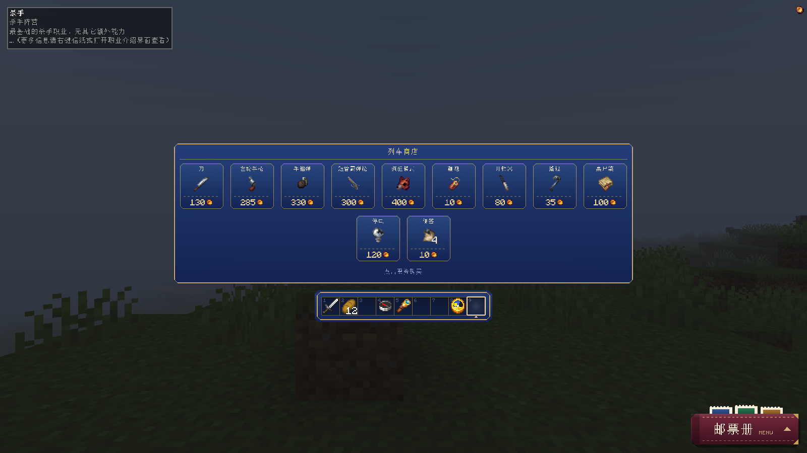
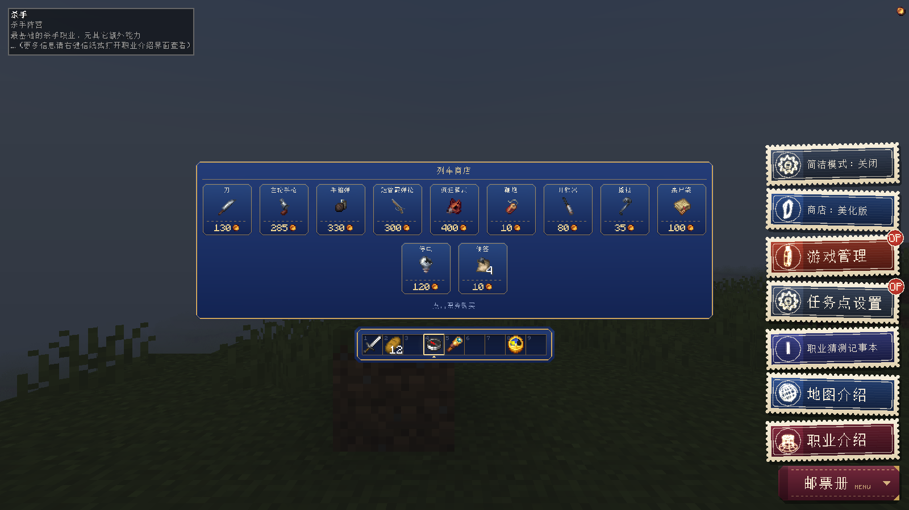
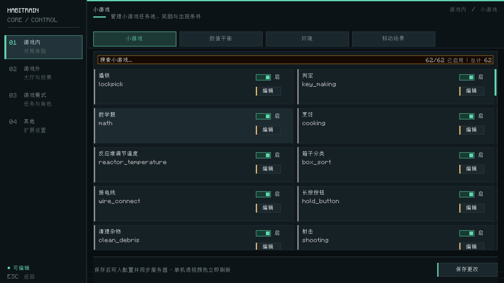
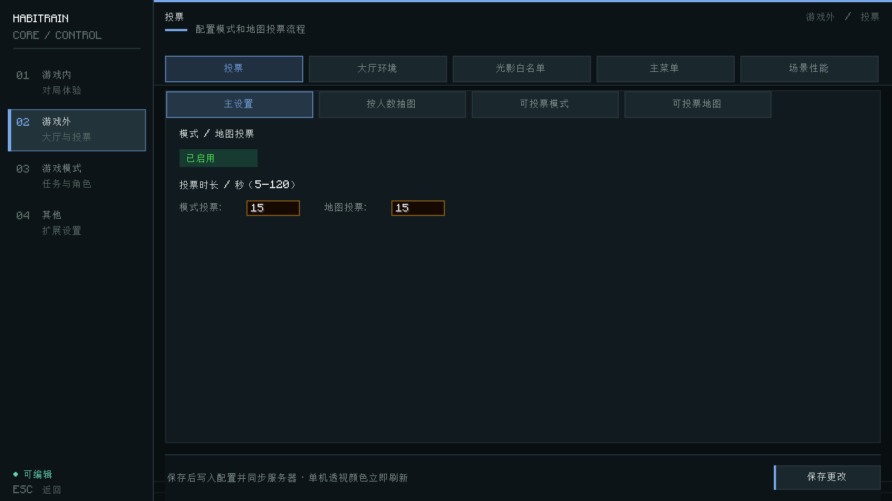
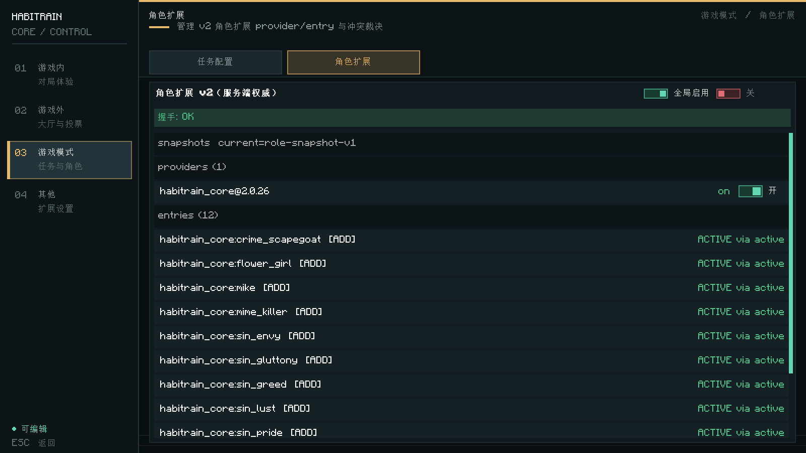

# 哈比列车核心 · HabiTrain Core

**为星穹列车增添玩法，也为附属模组提供扩展接口。**

HabiTrain Core 是面向 Minecraft 1.21.1 / Fabric 的《星穹列车》（StarRailExpress，简称 SRE）扩展模组。它补充角色与词条、投票选图、地图维修和车票式背包等功能，并向开发者开放任务、游戏模式、角色、对局、投票与移动场景 API。

[使用教程](docs/使用教程.md) · [安装依赖](docs/版本与安装依赖.md) · [API 参考](docs/API参考手册.md) · [角色扩展教程](docs/角色扩展API-v2使用教程.md)

| 项目 | 说明 |
|---|---|
| 游戏环境 | Minecraft **1.21.1** · Fabric Loader **≥ 0.18.2** · Java **21** |
| 模组 ID | `habitrain_core`，兼容旧依赖 ID `habitrain_taskapi` |
| 模组版本 | 以 [gradle.properties](gradle.properties) 中的 `mod_version` 为准 |
| API 版本 | 公开 API **2.3** · 角色扩展 API **2.0**，见 [CoreApi](src/main/java/com/habitrain/core/api/CoreApi.java) |
| SRE 前置 | 仓库 `libs/` 中固定的 **StarRailExpress 4.3.0** 成品 |
| 许可证 | [GPL-3.0](LICENSE) |

## 主要功能

| 方向 | 功能 |
|---|---|
| 角色与词条 | 替罪羊、卖花女、疾风、默杀者、Mike 五个投稿角色，七宗罪角色，以及七美德修饰符体系；慷慨沿用上游实现 |
| 模式与地图 | 桥接 SRE 游戏模式，先投模式再投地图，按在线人数筛选地图池，并提供地图介绍图与预设配置 |
| 地图维修 | 管理员进入创造模式维修地图；维修中的地图退出投票池，退出维修后恢复玩家原有状态 |
| 车票式背包 | 候车背包、邮票快捷菜单、对局邮票册与票券商店，支持简洁模式、键盘操作和窗口适配 |
| 对局体验 | 淘汰玩家休息区与观战切换、角色商店自适应布局、美化版与原版商店切换、MVP 结算展示 |
| 移动外景 | 列车窗外动态场景，支持直线与环绕运动、循环、环境音及镜头微震，也可由附属模组创建场景实例 |
| 环境与语音 | 分别设置大厅、对局和结算后的天气与时间，联动 Simple Voice Chat 管理语音群组 |
| 配置与管理 | 中文配置中心、角色扩展状态与冲突诊断、配置界面访问控制（MenuGate）、Iris 光影白名单 |

角色规则、功能开关及操作步骤见[使用教程](docs/使用教程.md)。

## 界面预览

**车票式背包**将旅客信息、参与 / 旁观切换、随身行李和快捷菜单放在一张乘车凭证上。


**票券商店**以蓝色票券展示商品与价格，随窗口空间调整布局和分页，并保留原版商店样式切换。



<details>
<summary>查看更多：简洁模式、邮票册与配置中心</summary>

**简洁模式**：点击对应邮票或按 `F6` 切换，使用静态头像与简化票面；选择保存在本机。


**对局邮票册**：展开后可切换简洁模式与商店样式，并打开职业介绍、地图介绍等页面。



**小游戏配置**：查看已注册的小游戏，进入各项任务的配置页。



**投票配置**：管理模式与地图的投票流程。



**角色扩展**：查看扩展提供方、条目状态与配置入口。



</details>

截图来自 Minecraft 1.21.1 开发客户端；背包、商店与邮票册画面于 2026-10-22 使用 2.0.26 源码拍摄。玩家、物品和价格仅作示例，操作说明见[背包车票界面](docs/背包车票界面.md)。

## 安装与依赖

1. 准备 Minecraft **1.21.1** 的 Fabric 实例，使用 Java **21** 和 Fabric Loader **0.18.2 或更高版本**。
2. 将 Core 成品 `habitrain_core-<version>.jar` 放入实例的 `mods/` 目录，联机双方使用相同版本。
3. 放入仓库提供的 [`libs/star_rail_express-4.3.0.jar`](libs/star_rail_express-4.3.0.jar)。
4. 按下表补齐依赖，再启动游戏检查加载结果。

### 固定 SRE 依赖

**请使用本仓库 `libs/` 中固定的 SRE 文件，不要从其他渠道下载或用其他分支自行构建的同版本 JAR 替换。** Core 调用并适配 SRE 内部接口，仅版本号一致不能保证兼容。

| 文件 | 用途 |
|---|---|
| [`star_rail_express-4.3.0.jar`](libs/star_rail_express-4.3.0.jar) | 玩家与服务器使用的成品，放入游戏实例的 `mods/` |
| [`star_rail_express-4.3.0-dev.jar`](libs/star_rail_express-4.3.0-dev.jar) | 仅供开发编译和开发运行使用，不放入普通游戏实例 |

两个文件不能互换。开发版使用 named 映射，且没有成品内嵌的部分依赖；开发项目中的引入方式见下方说明。

<details>
<summary>SRE 文件的 SHA-256 校验值</summary>

```text
star_rail_express-4.3.0.jar
081d4598a675be74a1351ad4c68602c1f80936f32f87352eee52c418e6906b21

star_rail_express-4.3.0-dev.jar
24ad766930a190d00b2e1fbd6703d4b72b96f9f9083935d1829b5e694c4498b6
```

在仓库根目录执行以下命令可校验成品：

```powershell
Get-FileHash .\libs\star_rail_express-4.3.0.jar -Algorithm SHA256
```

</details>

### 其余运行依赖

下表列出项目固定使用的版本；标注 `libs/` 的文件可直接从本仓库取得。

| 依赖 | 固定版本 | 安装来源 |
|---|---|---|
| Fabric API | 0.116.13+1.21.1 | 另装完整 Fabric API |
| DataSync | 0.10.2 | 另装；已有 Ratatouille 1.4.3 内嵌的同版本时无需重复 |
| Cardinal Components（base / entity / world / scoreboard） | 6.1.3 | 另装，四个模块均需满足要求 |
| Cloth Config | 15.0.140 | 另装 Fabric 版 |
| Mod Menu | 11.0.3 | 客户端另装；专用服限制见下文 |
| Wathe | 1.3.2-1.21.1 | [`libs/wathe-1.3.2.jar`](libs/wathe-1.3.2.jar) |
| Simple Voice Chat | 1.21.1-2.6.18 | [`libs/voicechat-fabric-1.21.1-2.6.18.jar`](libs/voicechat-fabric-1.21.1-2.6.18.jar) |
| Architectury | 13.0.11 | [`libs/architectury-13.0.11-fabric.jar`](libs/architectury-13.0.11-fabric.jar) |
| Exposure | 1.9.11 | [`libs/exposure-fabric-1.21.1-1.9.11.jar`](libs/exposure-fabric-1.21.1-1.9.11.jar) |
| SRE Resource | 1.0.3 | [`libs/sre-lib-1.0.3.jar`](libs/sre-lib-1.0.3.jar) |
| Forge Config API Port | 21.1.6 | [`libs/ForgeConfigAPIPort-v21.1.6-1.21.1-Fabric.jar`](libs/ForgeConfigAPIPort-v21.1.6-1.21.1-Fabric.jar) |

playerAnimator **2.0.4+1.21.1 已内嵌在 Core 中**。Simple Voice Chat 是固定 SRE 的必需依赖；Wathe、TACZ 内嵌的旧版 CCA / DataSync 不能单独满足 Core 的要求。

**专用服部署限制**：固定 SRE 4.3.0 强制依赖 Mod Menu，而 Mod Menu 11.0.3 仅用于客户端。部署前请阅读[专用服限制与启动验收](docs/版本与安装依赖.md#专用服限制与启动验收)，确认可用的服务端方案。完整依赖与内嵌组件说明见[版本与安装依赖](docs/版本与安装依赖.md)。

## 配置与常用命令

在 Mod Menu 中选择「哈比列车核心」即可打开配置中心，管理小游戏、数值平衡、投票、环境、角色扩展和移动场景等功能。

- 主配置：`config/habitrain_core.json`。
- 角色扩展配置：`config/habitrain_role_v2.json`。
- 联机时，服务端配置提交受 OP 权限与 MenuGate 控制；草稿、确认及冲突处理见[配置提交协议](docs/配置提交协议.md)。
- 对局中修改角色扩展会形成待生效快照，当前局继续使用开局快照；具体生效范围见[角色扩展教程](docs/角色扩展API-v2使用教程.md)。

以下常用命令均需 **OP 2** 权限；地图 ID 可用 `Tab` 补全。

| 命令 | 用途 |
|---|---|
| `/habi_api list` | 查看已注册的游戏模式 |
| `/habi_api vote start` | 开启模式与地图双阶段投票 |
| `/habi_api vote status` | 查看当前投票状态 |
| `/habi_api vote cancel` | 取消当前投票 |
| `/habi_api repair <地图ID>` | 进入指定地图的维修模式 |
| `/habi_api repair cancel` | 退出自己的维修模式 |
| `/habi_api repair list` | 查看维修人员与锁定地图 |
| `/habi_api scene status` | 查看地图级移动场景状态 |
| `/habitrain roleapi providers` | 查看已加载的角色扩展提供方 |
| `/habitrain roleapi list` | 查看当前有效角色目录 |
| `/instantgroup [range]` | 将范围内玩家加入临时语音群组，默认 128 格 |

更多管理命令见[使用教程](docs/使用教程.md)。Iris 光影白名单依赖客户端上报信息，无法防止修改后的客户端伪造上报。

## 开发附属模组

公开 API 根包为 **`com.habitrain.core.api.**`**。请通过公开接口扩展功能，避免在编译期引用 Core 内部实现包。

### 接入依赖

以下片段适用于与本仓库一致的 **Fabric 1.21.1 / Java 21 / Mojang 官方映射**项目。将 Core 成品与固定 SRE 开发版复制到附属模组的 `libs/`，把 `<version>` 替换为实际版本：

```groovy
dependencies {
    modImplementation files("libs/habitrain_core-<version>.jar")
    // SRE 开发版已经是 named 映射，使用 implementation，避免再次重映射。
    implementation files("libs/star_rail_express-4.3.0-dev.jar")
}
```

在附属模组的 `fabric.mod.json` 中合并以下依赖声明；示例最低 Core 版本对应当前源码版本：

```json
{
  "depends": {
    "fabricloader": ">=0.18.2",
    "minecraft": "~1.21.1",
    "java": ">=21",
    "fabric-api": "*",
    "habitrain_core": ">=2.0.26",
    "starrailexpress": "~4.3.0"
  }
}
```

这两项 JAR 引用只展示 Core 与 SRE 的接入方式。需要开发运行时，请参照本仓库 [build.gradle](build.gradle) 补齐 SRE 的外部依赖及开发版缺少的库，保留其依赖配置方式。

### 选择扩展入口

| 要做的事 | 主要入口 | 教程 |
|---|---|---|
| 注册任务与推进任务进度 | `TaskRegistry`、`TaskDefinition`、`TaskInstance` | [使用教程](docs/使用教程.md) |
| 注册游戏模式与处理胜利结果 | `GameModeRegistry`、`GameMode`、`WinResult` | [API 参考](docs/API参考手册.md) |
| 新增、修改、替换角色或建立别名 | `RoleExtensionEntrypoint`、`RoleDefinition`、`RolePatch`、`RoleReplacement` | [角色扩展 v2](docs/角色扩展API-v2使用教程.md) |
| 扩展角色状态与客户端交互 | `RoleStateApi`、`RoleStateClientApi`、`RoleScreenClientApi` | [角色扩展 v2](docs/角色扩展API-v2使用教程.md) |
| 读取对局状态与接收结算事件 | `MatchStateApi`、`MatchEvents`、`MatchSettlement` | [API 参考](docs/API参考手册.md) |
| 创建通用投票或模式 / 地图投票 | `OptionVoteApi`、`ModeMapVoteApi` | [API 参考](docs/API参考手册.md) |
| 创建和控制移动场景 | `SceneApi`、`SceneInstanceSpec`、`SceneProfileBuilder` | [移动场景 API](docs/移动场景API使用教程.md) |
| 控制配置界面访问 | `MenuGateApi`、`MenuGateClientApi` | [API 参考](docs/API参考手册.md) |

角色扩展通过 `habitrain:role_extensions`（common）和 `habitrain:role_client_extensions`（client）入口注册。角色 API v2 当前标记为 **preview / experimental**；v1 接口与兼容桥已移除，旧扩展需按[升级说明](docs/角色扩展API-v2使用教程.md#14-升级与包路径)迁移后重新编译。

模组产物版本、公开 API 版本与角色 API 版本相互独立。按能力分支时使用 `CoreApi.supports(key)`，能力键见 `CoreApi.capabilities()`；版本查询与装配状态的具体约定见 [CoreApi](src/main/java/com/habitrain/core/api/CoreApi.java)。

## 从源码构建

准备 Java **21**，保留仓库 `libs/` 中的固定依赖，并在仓库根目录使用自带的 Gradle Wrapper。

Windows / PowerShell：

```powershell
.\gradlew.bat build --no-daemon
```

Linux / macOS：

```sh
./gradlew build --no-daemon
```

普通成品位于 `build/libs/habitrain_core-<version>.jar`；`assemble` 还会将成品暂存到 `build/release/`。

启动开发客户端：

```powershell
.\gradlew.bat runClient --no-daemon
```

开发运行使用 SRE `-dev.jar`。发布验收应使用固定 SRE 成品与新构建的 Core，具体项目见[运行验收清单](docs/运行验收清单.md)。

## 文档索引

| 文档 | 内容 |
|---|---|
| [使用教程](docs/使用教程.md) | 玩法、配置、管理命令与任务开发 |
| [版本与安装依赖](docs/版本与安装依赖.md) | 固定版本、完整依赖、内嵌组件与专用服限制 |
| [背包车票界面](docs/背包车票界面.md) | 车票背包、邮票菜单、简洁模式与商店样式 |
| [API 参考手册](docs/API参考手册.md) | 公开接口、类型与调用契约 |
| [角色扩展 API v2](docs/角色扩展API-v2使用教程.md) | 角色定义、补丁、替换、状态、动作与客户端扩展 |
| [移动场景 API](docs/移动场景API使用教程.md) | 场景实例、资产、锚点、参数与生命周期 |
| [大厅移动背景](docs/大厅移动背景.md) | 大厅移动外景的配置与使用 |
| [配置提交协议](docs/配置提交协议.md) | 草稿、提交确认、权限与冲突处理 |
| [运行验收清单](docs/运行验收清单.md) | 成品启动与多人场景验收项 |

## 许可证与致谢

HabiTrain Core 采用 [GNU General Public License v3.0](LICENSE) 发布。

感谢 **Catmoon Train Team** 开发 StarRailExpress。仓库 `libs/` 中的 SRE JAR 作为固定依赖提供，采用 LGPL-3.0 许可；各第三方依赖的版权与许可归其原作者所有。
