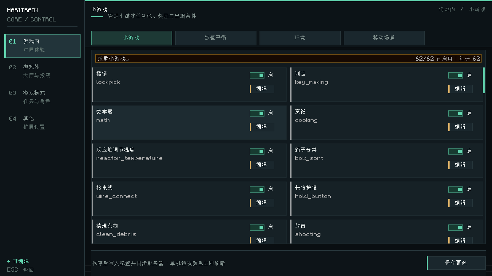
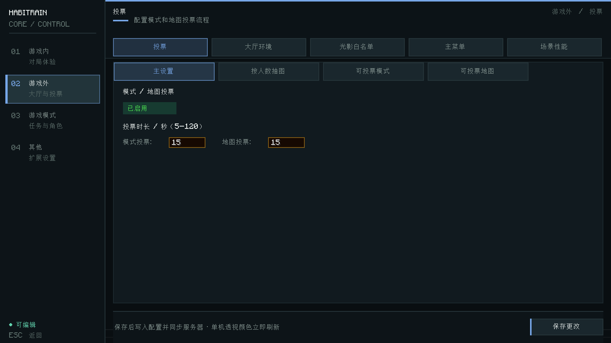
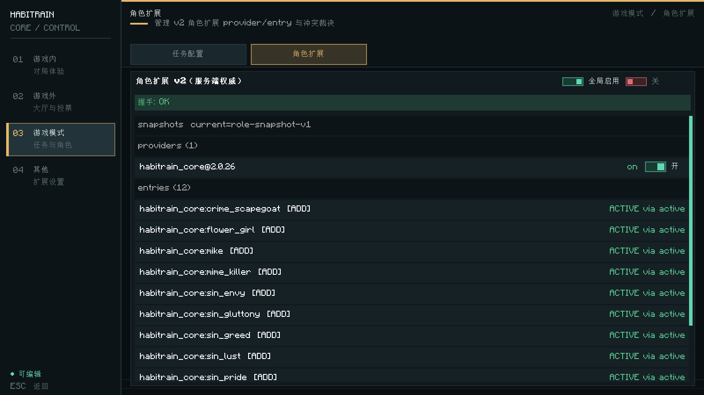

# 哈比列车核心 · HabiTrain Core

为 Minecraft 1.21.1 / Fabric 下的《星穹列车》（StarRailExpress，简称 SRE）提供玩法扩展、可视化配置和附属模组开发接口。模组 ID 为 `habitrain_core`。

Core 扩展角色与对局体验，提供任务配置工具，并将角色扩展、游戏模式、投票和移动场景等能力开放给下游模组。

[使用教程](docs/使用教程.md) · [安装依赖](docs/版本与安装依赖.md) · [API 参考手册](docs/API参考手册.md) · [角色扩展教程](docs/角色扩展API-v2使用教程.md)

## 主要功能

| 方向 | 提供的功能 |
|---|---|
| 角色与词条 | 替罪羊、卖花女、疾风、默杀者、Mike 五个投稿角色；七宗罪角色；七美德修饰符体系，其中慷慨沿用上游实现 |
| 模式与地图 | 桥接上游游戏模式，提供模式与地图双阶段投票、按人数筛选地图池，以及地图介绍图和预设配置 |
| 地图维修 | 管理员进入创造模式维修地图；维修中的地图暂时退出投票池，退出维修时恢复玩家原有状态 |
| 对局体验 | 淘汰玩家休息区与观战切换、角色商店自适应布局、美化版与原版商店切换，以及 MVP 结算界面 |
| 移动场景 | 配置列车窗外动态外景，支持直线与环绕运动、循环、环境音和镜头微震；附属模组可通过 API 创建场景实例 |
| 环境与语音 | 分别配置大厅、对局和结算后的天气与时间；联动 Simple Voice Chat 管理语音群组 |
| 配置与管理 | 中文配置中心、角色扩展状态与冲突诊断、配置界面访问控制，以及 Iris 光影白名单检查 |

角色规则、功能开关与操作步骤见[使用教程](docs/使用教程.md)。

## 游戏截图

以下画面截取自实际运行的 Minecraft 1.21.1 开发客户端。

**小游戏配置**：查看已注册的小游戏，并进入各项任务的配置页面。



**投票配置**：管理模式与地图的投票流程。



**角色扩展**：查看角色扩展提供方、条目状态和配置入口。



## 安装

### 运行环境

| 项目 | 版本 |
|---|---|
| Minecraft | 1.21.1 |
| Java | 推荐使用 Java 21 |
| Fabric Loader | 0.18.2 或更高 |
| Fabric API | 项目固定版本为 0.116.13+1.21.1 |
| StarRailExpress | 本仓库提供的固定 4.3.0 成品 |

Core 的当前版本见 [gradle.properties](gradle.properties) 中的 `mod_version`。上表只列出主要环境要求，完整安装清单见[版本与安装依赖](docs/版本与安装依赖.md)。

### 安装步骤

1. 准备 Minecraft 1.21.1 的 Fabric 实例，并确认使用兼容 Java 21 字节码的运行环境。
2. 将 Core 成品 JAR 和安装清单中的依赖放入实例的 `mods` 目录。自行构建的 Core 成品位于 `build/libs/`。
3. SRE 必须使用仓库中的 [`libs/star_rail_express-4.3.0.jar`](libs/star_rail_express-4.3.0.jar)。请保留该固定文件；`star_rail_express-4.3.0-dev.jar` 仅供开发编译使用。
4. 按安装清单核对 DataSync、CCA 四模块及 SRE 的依赖，再启动实例检查加载结果。

Core 已内嵌 playerAnimator，其余开发运行依赖并不会全部随 Core 打包。Simple Voice Chat 虽然在 Core 元数据中列为建议项，但它是固定 SRE 成品的硬依赖，安装时仍需提供。

**专用服部署**：固定 SRE 4.3.0 强制依赖 Mod Menu，而固定 Mod Menu 版本仅用于客户端。部署前请阅读[专用服限制与启动验收](docs/版本与安装依赖.md#专用服限制与启动验收)，确认并验证所用的服务端方案。

## 配置与常用操作

在 Mod Menu 中选择「哈比列车核心」，点击配置按钮即可进入控制台。

| 分类 | 配置内容 |
|---|---|
| 游戏内 | 小游戏、数值平衡、环境、移动场景 |
| 游戏外 | 投票、大厅环境、光影白名单、主菜单背景、移动场景性能 |
| 游戏模式 | 任务配置、角色扩展 |
| 其他 | 兼容性选项和其他扩展设置 |

主要配置保存在 `config/habitrain_core.json`；角色扩展配置使用 `config/habitrain_role_v2.json`。联机环境中的服务端配置受权限与 MenuGate 控制，配置提交、确认及冲突处理见[配置提交协议](docs/配置提交协议.md)。

角色扩展配置在大厅应用到大厅快照；对局中的变更会形成待生效快照，当前局的角色行为继续使用本局快照。具体生效范围见[角色扩展 API v2 使用教程](docs/角色扩展API-v2使用教程.md)。

光影白名单依赖正常客户端上报 Iris 光影信息，不能防止修改客户端伪造上报。

### 常用命令

以下命令均需 OP 2 权限。地图 ID 可通过游戏内命令补全查询。

| 命令 | 用途 |
|---|---|
| `/habi_api list` | 查看已注册的游戏模式 |
| `/habi_api vote start` | 开启模式与地图双阶段投票 |
| `/habi_api vote status` | 查看投票阶段和剩余时间 |
| `/habi_api vote cancel` | 取消当前投票 |
| `/habi_api repair <map>` | 进入指定地图的维修模式 |
| `/habi_api repair cancel` | 退出自己的维修模式 |
| `/habi_api repair list` | 查看维修人员和锁定地图 |
| `/instantgroup [range]` | 将范围内玩家加入临时语音群组，默认范围为 128 格 |
| `/habitrain roleapi providers` | 查看已加载的角色扩展提供方 |
| `/habitrain roleapi list` | 查看当前有效角色目录 |
| `/habi_api scene status` | 查看地图级移动场景状态 |

更多维修、门控、角色诊断和场景管理命令见[使用教程](docs/使用教程.md)。

## 开发附属模组

公开 API 位于 `com.habitrain.core.api.**`。下游模组应通过公开接口扩展功能，避免编译期依赖 Core 的内部实现包。

| 扩展方向 | 主要入口 | 文档 |
|---|---|---|
| 版本与能力查询 | `CoreApi` | [API 参考手册](docs/API参考手册.md) |
| 自定义任务 | `TaskRegistry`、`TaskDefinition`、`TaskInstance` | [使用教程](docs/使用教程.md) |
| 游戏模式 | `GameModeRegistry`、`GameMode`、`WinResult` | [API 参考手册](docs/API参考手册.md) |
| 角色扩展 v2 | `RoleExtensionEntrypoint`、`RoleDefinition`、`RolePatch` | [角色扩展教程](docs/角色扩展API-v2使用教程.md) |
| 角色状态与客户端交互 | `RoleStateApi`、`RoleStateClientApi`、`RoleScreenClientApi` | [角色扩展教程](docs/角色扩展API-v2使用教程.md) |
| 对局状态与结算 | `MatchStateApi`、`MatchEvents`、`MatchSettlement` | [API 参考手册](docs/API参考手册.md) |
| 投票 | `OptionVoteApi`、`ModeMapVoteApi` | [API 参考手册](docs/API参考手册.md) |
| 移动场景 | `SceneApi`、`SceneInstanceSpec`、`SceneProfileBuilder` | [移动场景教程](docs/移动场景API使用教程.md) |

### 注册一个任务

在模组初始化阶段注册任务。下面的例子定义一个需要完成三次进度的维修任务，具体交互由附属模组推进。

```java
import com.habitrain.core.api.TaskCategory;
import com.habitrain.core.api.TaskRegistry;

TaskRegistry.register("my_mod", "repair_radio", builder -> builder
        .displayName("维修无线电台")
        .category(TaskCategory.ALL)
        .gameMode("sre:base")
        .timeLimit(60)
        .onAssign((player, task) -> task.setMaxProgress(3))
        .completionChecker((player, task) ->
                task.getProgress() >= task.getMaxProgress()));
```

任务分配、进度更新、完成回调和临时道具回收见[使用教程](docs/使用教程.md)。

### 版本兼容

产物版本、公开 API 版本和角色扩展 API 版本分别维护。下游查询接口能力时使用 `CoreApi.apiVersion()`、`CoreApi.roleApiVersion()` 和 `CoreApi.supports(key)`，具体契约以 [CoreApi](src/main/java/com/habitrain/core/api/CoreApi.java) 为准。

角色扩展 v1 及其兼容桥已移除，角色声明使用 `api.role.v2`。旧附属模组需要按[迁移说明](docs/角色扩展API-v2使用教程.md#14-升级与包路径)调整并重新编译。

## 从源码构建

使用 Java 21 和仓库自带的 Gradle Wrapper。在项目根目录运行：

```powershell
.\gradlew.bat build --no-daemon
```

成品路径如下，`<version>` 对应 `gradle.properties` 中的 `mod_version`：

```text
build/libs/habitrain_core-<version>.jar
```

启动开发客户端：

```powershell
.\gradlew.bat runClient --no-daemon
```

构建使用 `libs/` 中固定的本地依赖，其中 SRE 使用开发版 JAR。请保留这些构建输入，并按[安装依赖文档](docs/版本与安装依赖.md)区分开发环境和成品运行环境。

## 文档

| 文档 | 内容 |
|---|---|
| [使用教程](docs/使用教程.md) | 玩法、配置、管理命令与任务开发 |
| [版本与安装依赖](docs/版本与安装依赖.md) | 版本来源、完整依赖清单与专用服限制 |
| [API 参考手册](docs/API参考手册.md) | 公开接口、类型和调用契约 |
| [角色扩展 API v2 使用教程](docs/角色扩展API-v2使用教程.md) | 新增角色、补丁、替换、状态、事件与客户端扩展 |
| [移动场景 API 使用教程](docs/移动场景API使用教程.md) | 场景实例、资产、锚点、参数与生命周期 |
| [大厅移动背景](docs/大厅移动背景.md) | 大厅移动外景的配置与使用 |
| [配置提交协议](docs/配置提交协议.md) | 配置草稿、提交确认、权限与冲突处理 |

## 许可证

本项目采用 [GNU General Public License v3.0](LICENSE)。
